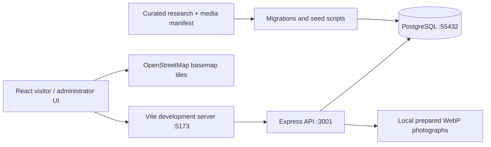

# Architecture and API — version 1

## Application structure

React 19 and React Router provide the visitor and administrator interface. Vite serves development assets on port 5173 and proxies `/api` and `/media` to Express on port 3001. PostgreSQL stores the catalogue and sessions. For local development, embedded-postgres manages a persistent project database on port 55432. Leaflet and markercluster provide map exploration. Sharp creates responsive WebP files.

## Public routes

| Page | Purpose |
| --- | --- |
| `/` | Archive introduction |
| `/catalogue` | Search, filters and comparison selection |
| `/buildings/:slug` | Monument dossier, images, life story and references |
| `/compare?ids=1,2` | Two distinct published building records |
| `/anatomy?building=slug` | Curated image hotspots |
| `/across-time` | Building-date ranges with optional element and CE range filters |
| `/photographs` | Two-image zoom/pan/full-screen workspace |
| `/life-stories?building=slug` | Independently sourced events |
| `/map` | Clustered site references and shared filters |
| `/statistics` | Published-catalogue aggregations |
| `/about` | Archive context and sources |
| `/admin` | Administrator login and management |

## API overview

All paths below begin with `/api`. See `server/app.mjs`, `server/catalogue.mjs`, `server/explore.mjs` and `server/life-events.mjs` for the exact validated payload contracts.

| Method / endpoint | Behaviour |
| --- | --- |
| `GET /health` | Database connectivity health check |
| `GET /taxonomy`, `/sites` | Controlled terms, sources and locations |
| `GET /buildings` | Published results; `q`, comma-separated `states` names and `sites/types/materials/elements` IDs, `page`, `limit` (max 120), `sort` |
| `GET /buildings/:slug` | Published detail and approved images |
| `GET /buildings/:slug/events` | Sourced events in chronological order |
| `GET /compare?ids=a,b` | Shared and distinct documented features with references |
| `GET /explore/anatomy?building=slug` | Curated photographs, hotspots and related records |
| `GET /explore/time?element=id&from=500&to=1600` | Inclusive date-range overlap and undated records |
| `GET /statistics` | Collection aggregations |
| `GET /auth/session` | Authentication state and CSRF token |
| `POST /auth/login`, `/auth/logout` | Session authentication; CSRF required |
| `GET /admin/buildings`, `/admin/buildings/:id` | Includes unpublished records; authentication required |
| `POST /admin/buildings`, `PUT /admin/buildings/:id` | Validated transactional catalogue writes |
| `GET/POST /admin/buildings/:id/events` | List/create separate life events |
| `PUT/DELETE /admin/buildings/:id/events/:eventId` | Modify/remove an event within that building |
| `POST /admin/sources`, `/admin/taxonomy/:kind` | Add references or supported controlled terms |

Authenticated mutations require the session cookie and `X-CSRF-Token`. A life-event payload contains `kind`, `title`, `description`, `year_from`, `year_to`, `precision`, `source_id` and `locator`. Event kinds: construction, addition, alteration, restoration, use, recognition. Precision: year, approximate, range. Dates must be ordered years -1000–2100; negative integers denote BCE, positive integers CE, and zero is rejected.

## Integrity boundaries

Parameterized SQL prevents values being interpolated into queries. Zod validates API payloads. Foreign keys/checks/unique indexes enforce relationships and dates. Building saves use a transaction; invalid associated records roll back the save. Event writes are independent single-record operations. Publishing prerequisites and hotspot evidence checks are application rules, not SQL triggers. Admin sessions are stored in PostgreSQL; secure cookies and proxy trust depend on production configuration.

Map filters use the catalogue API; the area filter is applied to returned coordinates in the browser and is not a PostGIS query. Site reference positions must not be used as exact navigation coordinates. Life-event order does not imply influence or causation.

## Optional DBMS Lab API

See [DBMS Lab boundaries and endpoints](dbms-lab.md). `GET /api/lab/schema`, `GET /api/lab/tables/:name`, `POST /api/lab/query`, `POST /api/lab/practice` and `POST /api/lab/performance` provide allowlisted metadata, public samples, fixed read-only query templates and connection-local temporary exercises. No arbitrary SQL endpoint is provided.
