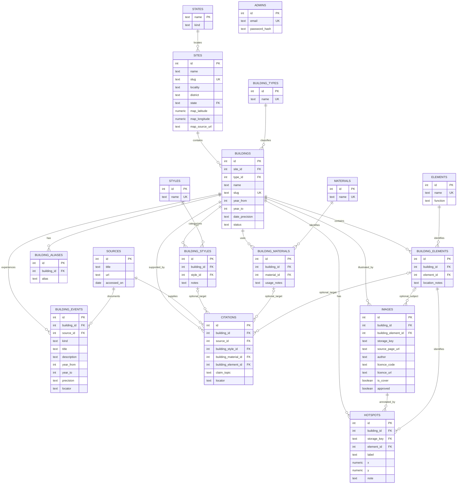

# Vastukala — ER Diagram

Current implementation model, 1 November 2026, aligned with migrations 001–006. The diagram shows domain entities, relationships and selected fields; the detailed field inventory is in plan.md. PostgreSQL session storage is an implementation table outside this domain view.

## Interpretation and constraints

- Each building belongs to one site and has one primary building type in V1. A site/type may exist before any buildings are added.
- Buildings have many-to-many relationships with styles, materials, and elements through the three junction tables. Each pair is unique.
- Each citation references one building and one source. It may additionally target one specific linked style, material, or element; at most one target is set. With none set, claim_topic identifies a building-level fact such as construction period.
- Composite foreign keys ensure that targeted relationships and image elements belong to the same building. This prevents a photograph or citation from accidentally referring to a different monument's element.
- An image belongs to exactly one building and optionally a documented element occurrence. Site panoramas are contextual editorial media unless they can be assigned accurately to a building.
- The administrator is an access-control entity; no authorship relationship is implied. Content audit history can be added later if required.
- Drafts may have no media or citations. Publication requires a cover photograph and supporting citation; a partial unique index permits at most one cover per building.
- Unknown dates and attributes remain unknown. Absence of an element link means it is not documented in this database, not proof that the building lacks that element.
- Hotspots use composite image and element-occurrence keys within a building, not mutable association-row IDs. Percentage coordinates are bounded, and each image/element pair has at most one marker. Element-specific citation validation is application-level. The `seed_tasks` curation marker table is infrastructure outside the domain diagram.

- Building events require one building and one source, bounded ordered BCE/CE dates and an allowed event type. Ordinary building edits preserve event records. Site map coordinates are approximate references separate from individual building coordinates.

## National expansion — 31 October 2026

State/UT names are natural keys in `states`. The existing `sites.state` column now references that controlled dimension, preserving earlier site IDs. No duplicate state column is introduced. BCE dates use negative integers, CE dates positive integers; event year zero is rejected.

## Visual diagram package — 1 November 2026

The generated [11-page vector PDF](../output/pdf/Vastukala-ER-Diagrams.pdf) includes the whole content model, subsystem diagrams, authentication/runtime entities, derived view lineage, temporary DBMS Lab tables, a complete foreign-key register and unique-key rules. The snapshot contains 20 permanent tables, 119 columns and 22 foreign keys.

Editable Graphviz DOT and SVG files are in `docs/diagrams/`; the metadata snapshot contains schema definitions only, never account or session values. Generate layouts with `node scripts/render-er-graphs.mjs`, then build the PDF with `python scripts/build-er-pdf.py` using a Python environment with reportlab and pypdf. The layout script uses `@viz-js/viz` from the bundled runtime, or the directory supplied through `CODEX_NODE_MODULES`.

The DBMS Lab temporary tables are not part of the persistent catalogue. Their nullable practice FKs are deliberately shown as optional. A SQL view is identified as derived data, and no undocumented administrator/session FK is invented.
